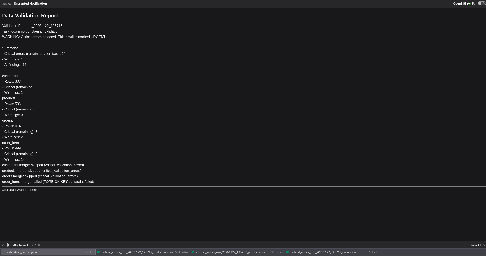

# Database Analysis Example

An example validation pipeline for database staging tables that runs predefined checks, applies automated fixes, performs AI-assisted analysis, and merges clean data into production tables. Includes change logging for full rollback capability. This is not production ready, and was made purely as a showcase over a short period of time, and will not be maintained. I'ts lacking quite a few key features. 

For example, as of right now, it will update/insert destination tables that have no critical errors even if they depend on other tables in production that do have critical errors. For production I'd want to avoid that. It's also missing a lot of the typical SQL validation checks against the production database, fact and dim table join checks etc, and it's not checking for duplication or anything else like that.


Because this is doing row level checks, it would be EXTREMELY slow on large data sets. 

Much of the auto_fix and data_validate code was borrowed from my own personal DB injest processes, and are mostly scripts run through either Node Red, or other scripts injestion into Home Assistant. Simply bundled into a singlular package for showcasing. There are many other checks and "auto_fixes" I use for things like news, weather, and router/firewall logs that didn't make it into this. I mostly just grabbed ones that would be mostly universal, and wouldn't comprimise me or my systems in any way. 

# AI Usage disclosure
There has been some assistance from AI, but most of this comes from my personal ingestion processes I use either for Homeassistant, or other things I use to monitor my home network, or news feeds etc. And some older projects as well.

Anyways! The TLDR is this is my typical project structure I've used for ingestion validation, but without any of my actual prod DB monitoring or auto fixs. 


## Features

- **Multi-database support**: SQLite, MySQL, and PostgreSQL
- **Predefined validation checks**: 30+ checks across 7 categories (null, range, enum, cross-field, format, statistical, regex) with "Critcal" flagging options to prevent load
- **Auto-fixes**: Sign-flip correction, tenfold value detection, placeholder text handling, cross-reference (SQL join) fixes, designed to handle common errors such as form mistakes etc. There are dragons living here though, automated fixes can inadvertently change data incorrectly. Flags for fixes can be added to columns in ./tasks.json.
- **AI analysis**: LM Studio (or OpenAI/Anthropic) advisory analysis after predefined checks; never blocks merges for AI warnings
- **Change logging**: Before/after snapshots in both DB table and JSON files for full rollback
- **PGP encryption**: Optional encrypted email reports (Example keys in `./encryption_keys`)
- **Email reporting**: Toggle on/off via CLI flag; urgent flagging for critical errors, and normalized injest reporting.
- **Critical error CSV**: Per-table CSV attachments with row and reason details, output to ./otuputs and attached as an email. 

## Setup

1. **Clone the repository**
  Clone to a working directory. 
   ```bash
   cd database_analysis_showcase
   ```

2. **Create a virtual environment**
   ```bash
   python -m venv .venv
   source .venv/bin/activate  # Linux/Mac
   # .venv\Scripts\activate  # Windows
   ```

3. **Install dependencies**
   ```bash
   pip install -r requirements.txt
   ```

4. **Configure environment**
   ```bash
   cp secrets.env.example secrets.env
   # Edit secrets.env with your SMTP, PGP, and AI model settings etc. I use LM Studio for the AI analysis, but any openai compatible endpoint "should" work
   ```

5. **Set up LM Studio for AI analysis** (Or use an Openai like api endpoint)
   - Download [LM Studio](https://lmstudio.ai/)
   - Load a model (Qwen3 recommended) (I used a 27b qwen 3.6 model run locally)
   - Start the local server (default: http://127.0.0.1:1234/v1)

## How to Run

### Example 1: Run with the default tasks.json

The repository includes a sample validation project in `tasks.json` that validates the staging tables in `test_dbs/ecomerce_full.db`. An untouched backup exists here. `test_dbs/backups/ecomerce_full_backup.db` before the example run in `test_dbs/ecomerce_full.db`.

```bash
python start.py
```

This will:
1. Clone staging tables to autofix tables
2. Apply auto-fixes (sign-flip, zero-clamp, tenfold, placeholder text, cross-reference)
3. Run all predefined validation checks
4. Log critical errors and generate per-table CSV files
5. Run AI analysis on the validated data
6. Attempt merges (blocked if critical errors remain)
7. Generate a validation report in `outputs/validation_report.json`
8. Write a changelog to `logs/changelogs/`
9. Send an email with attachments (unless `--no-email` is used)

To run without sending email:
```bash
python start.py --no-email
```

To run with a custom task file:
```bash
python start.py path/to/my_task.json
```

### Example 2: Run as Flask API server

Start the server:
```bash
python start.py --server --host 0.0.0.0 --port 5000
```

**Health check:**
```bash
curl http://localhost:5000/health
# Response: {"status": "ok"}
```

**Run validation by POSTing a task JSON:**
```bash
curl -X POST http://localhost:5000/validate \
  -H "Content-Type: application/json" \
  -d @tasks.json
```

**Run validation by uploading a file:**
```bash
curl -X POST http://localhost:5000/validate/file \
  -F "file=@tasks.json"
```

**Disable email via query parameter:**
```bash
curl -X POST "http://localhost:5000/validate?no_email=true" \
  -H "Content-Type: application/json" \
  -d @tasks.json
```

## Task Configuration

Tasks are defined in JSON. See `tasks.json` for a full example. Key sections:

```json
{
  "tasks": [
    {
      "name": "my_validation",
      "database": {"type": "sqlite", "path": "test_dbs/my.db"},
      "merge_order": ["customers", "products", "orders"],
      "tables": {
        "customers": {
          "staging_table": "staging_customers",
          "target_table": "customers",
          "key_column": "customer_id",
          "columns": ["customer_id", "email", "full_name"],
          "checks": [
            {"type": "required", "column": "email", "severity": "critical"},
            {"type": "regex", "function": "is_valid_email", "column": "email", "severity": "critical"}
          ],
          "auto_fixes": ["fix_placeholder_email", "fix_sentinel_dates"]
        }
      },
      "ai_analysis": {
        "enabled": true,
        "provider": "lmstudio",
        "details": "Dataset-specific caveats for AI analysis"
      },
      "changelog": {
        "enabled": true,
        "db_table": "change_log",
        "json_dir": "logs/changelogs/"
      },
      "reporting": {
        "output_path": "outputs/validation_report.json",
        "email_on_complete": false,
        "local_only": true,
        "force_urgent": false
      }
    }
  ]
}
```

### Severity Levels

- `critical`: Blocks merge; must be 0 remaining errors to proceed
- `warning`: Reported but does not block
- `info`: Informational only

### Database Types

| Type | Required Config |
|------|---------------|
| `sqlite` | `path` |
| `mysql` | `host`, `port`, `database`, `user`, `password` |
| `postgres` | `host`, `port`, `database`, `user`, `password` |

### Auto-Fix Names

Available auto-fixes (register in `tasks.json` under `auto_fixes`):

**Generic (`functions/auto_fixes/_general_purpose/`):**
- `fix_negative_prices`-related: `fix_unit_price_sign_flipped`, `fix_unit_price_tenfold`
- `fix_negative_stock`-related: `fix_stock_qty_sign_flipped`, `fix_stock_qty_tenfold`
- `fix_negative_quantity`-related: `fix_quantity_sign_flipped`, `fix_quantity_tenfold`, `fix_quantity_zero`
- `fix_line_total_recalc`: recalculate line_total as quantity x unit_price
- `fix_placeholder_email`: generate email from name pattern
- `fix_placeholder_country`: derive country from city mapping
- `fix_invalid_emails`: alias for fix_placeholder_email
- `fix_missing_values`: fill missing values with defaults
- `fix_sentinel_dates`: clear sentinel dates (nullable columns)
- `fix_impossible_status_dates`: fix delivered/shipped without ship_date
- `fix_sentinel_order_dates`: clear sentinel order/ship dates

**Cross-reference (`functions/auto_fixes/dirty_ecommerce/`):**
- `fix_order_country_from_customer`: SQL join: correct order country from customer table
- `fix_order_items_price_from_product`: SQL join: correct item price from product table

## AI Analysis Explained

AI analysis runs **after** all predefined validation checks and auto-fixes have completed. It is **advisory only** and **never blocks** merges.

### How It Works

1. **Collects** schema info, validation summary, and sample rows (limited to 20 rows for token efficiency)
2. **Builds** a structured prompt that includes:
   - Table schemas
   - Validation results summary (error counts per table)
   - Sample data (first N rows)
   - Optional `details` field for dataset-specific caveats
3. **Sends** to the configured LLM (LM Studio, OpenAI, or Anthropic)
4. **Parses** the JSON response into findings with: `finding_type`, `description`, `severity`, `affected_columns`, `confidence`
5. **Appends** findings to the validation report (no merge blocking)

### What the AI Looks For

The AI prompt is instructed to analyze the dataset for:
- Anomalies and suspicious patterns not caught by predefined checks
- "Plausible but wrong" values that look valid individually but fail cross-field checks
- Data quality issues beyond what regex/range checks cover

### Supported Providers

| Provider | Config | Environment Variables |
|----------|--------|----------------------|
| LM Studio (default) | `provider: "lmstudio"` | `LM_STUDIO_URL`, `LM_STUDIO_MODEL`, `LM_STUDIO_API_KEY` |
| OpenAI | `provider: "openai"` | `OPENAI_API_KEY` |

Only LM Studio has been tested. But utilized the openai API standard for it.

### Important Notes

- Sample sizes are limited to reduce token usage
- AI findings appear in the report but do **not** block merges
- The `details` field in `ai_analysis` config allows dataset-specific caveats to be injected into the prompt. This allows for adding context to the dataset when needed.

## Critical Error Handling

### What Counts as "Critical"

Only validation checks with `"severity": "critical"` that **remain after auto-fixes** has been run are counted as critical errors. Auto-fixes run before validation, so issues fixed by auto-fixes do not appear in the results. These would be expected issues, such as datetime format mismatches, leading and trailing spaces etc. 

### Where Critical Errors Appear

1. **Console output**: Per-table summary with affected rows and reasons
2. **CSV files**: `outputs/critical_errors_{run_id}_{table}.csv`: one file per table (only if < 100 errors) this can  be changed. But was left at 100 to prevent exceeding email attachment size.
3. **Email**: Attached as CSV files alongside the json validation report (encrypted if PGP enabled) CSV files will be skipped on tables that do not have errors. 
4. **JSON report**: Embedded in the `validation_summary` section

### Urgent Email Flag

Emails are automatically marked **URGENT** when:
- Critical errors remain after all fixes, OR
- `force_urgent: true` is set in the reporting config

Urgent emails include `[URGENT]` in the subject, `X-Priority: 1` headers, and a warning in the body.

### Example Email

An example of a validation report email (with PGP encryption enabled) is shown below:



### Critical Errors and Merges

Tables with any remaining critical errors are **skipped** during the merge phase. Other tables without critical errors can still be merged (subject to foreign key constraints).

## PGP Encryption

Example key pairs are provided in `encryption_keys/`:
- `example_sender_secret.asc` / `example_sender_public.asc`: sender identity
- `example_recipient_public.asc`: recipient identity

To use PGP-encrypted reports:
1. Set in `secrets.env`:
   - `PGP_ENABLED=true`
   - `PGP_PRIVATE_KEY_PATH=encryption_keys/example_sender_secret.asc`
   - `PGP_RECIPIENT_KEYS=encryption_keys/example_recipient_public.asc`
   - `PGP_PRIVATE_KEY_PASSWORD=` (empty for example keys)
2. Set `pgp_enabled: true` in reporting config (via env substitution)

When PGP is enabled, the **entire email** (body + attachments) is encrypted as one unit. Attachments are not separately encrypted: they are included in the encrypted email.

For production, generate your own key pairs:
```bash
gpg --gen-key
gpg --armor --export-secret-keys your@email.com > encryption_keys/your_secret.asc
gpg --armor --export your@email.com > encryption_keys/your_public.asc
```

Note: `.gitignore` ignores all `*.asc` except `example_*` files.

## Changelog & Rollback

Every merge operation logs:
- **Database table** (`change_log`): Row-level insert/update with before/after JSON snapshots
- **JSON files** (`logs/changelogs/{run_id}.json`): Full run summary with validation results, AI findings, and table operations

To roll back, use the changelog entries to reconstruct original values from `before_state` JSON.

## Environment Variables

See `secrets.env.example` for all available variables:

| Variable | Description |
|----------|-------------|
| `LM_STUDIO_URL` | LM Studio API URL |
| `LM_STUDIO_MODEL` | Model ID loaded in LM Studio |
| `LM_STUDIO_API_KEY` | API key (default: lm-studio) |
| `SMTP_HOST` | SMTP server host |
| `SMTP_PORT` | SMTP port (587) |
| `SMTP_EMAIL` | Sender email address |
| `SMTP_PASSWORD` | SMTP password |
| `SMTP_AUTH` | Enable SMTP auth (true/false) |
| `SMTP_USE_SSL` | Use SSL (true/false) |
| `SMTP_START_TLS` | Use STARTTLS (true/false) |
| `PGP_ENABLED` | Enable PGP encryption |
| `PGP_PRIVATE_KEY_PATH` | Path to sender private key |
| `PGP_RECIPIENT_KEYS` | Comma-separated recipient public keys |
| `EMAIL_TO` | Comma-separated recipient emails |
| `EMAIL_CC` | Comma-separated CC emails |
| `EMAIL_BCC` | Comma-separated BCC emails |
